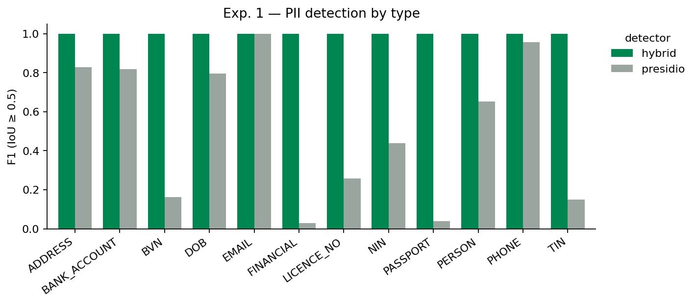
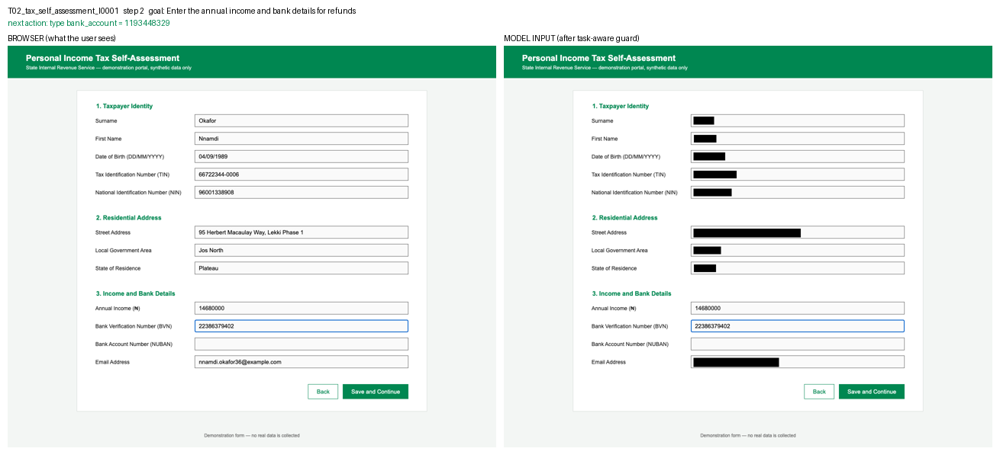
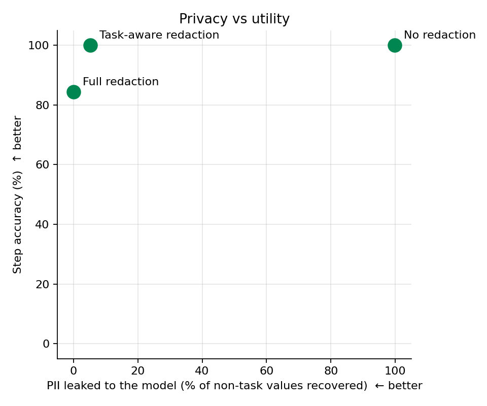

# Proof of Concept — progress report for the project supervisor

**Project:** Data minimization at the perception layer for screenshot-driven AI agents\
**Context:** Nigerian government e-services\
**Stage:** proof of concept built and evaluated · 15 October 2026 · objectives and scope aligned with the revised Chapter One on 9 November 2026 · Experiments 2 and 3 run on 13 November 2026\
**Repository:** https://github.com/Qubai-B/project · full technical record in `PROJECT_RECORD.md`

---

## 1. What this document is

A summary of what has been done since Chapter One, the decisions taken along the way, the results
obtained so far, what remains, and the points on which your guidance would help. Everything described
here is reproducible from the repository with one setup command and one run command (see §8).

## 2. Recap of the aim

Chapter One identified that AI agents which operate government portals by reading screenshots send
those screenshots, full of personal data, to cloud-hosted models, and that no current governance
framework covers this visual channel. The aim is a *visual redaction guard* that masks personal
information in a screenshot before it leaves the user's machine, without stopping the agent from
completing its task.

The revised Chapter One sets five objectives, and the tables below are numbered against them:
(1) a benchmark of annotated screenshots of mock Nigerian e-service forms; (2) a lightweight guard
that identifies personal data from its form-field label, with a full and a task-aware policy;
(3) detection accuracy against the benchmark, compared with a general-purpose detector;
(4) reduction of privacy leakage, measured by what a vision model can still read; and (5) impact on
agent performance, measured by next-action choice on recorded trajectories. Paperasse is an
illustrative reference system only; integrating the guard into it is not part of the project.

## 3. Decisions taken to make this feasible as an undergraduate project

| Decision | Reason |
|---|---|
| **Nigerian context throughout** — tax self-assessment (State IRS), driver's licence renewal (FRSC), international passport application (NIS) | Services citizens actually use online; brings in identifiers (NIN, BVN, TIN, NUBAN, passport/licence formats) that off-the-shelf privacy tools do not know. Housing benefit was dropped as not applicable to Nigeria. |
| **No autonomous browser agent is built** | Building one is a project in itself and its randomness would swamp the measurements. The agent is *demonstrated* instead: utility is measured by asking a model to predict one step at a time on recorded gold trajectories (the standard offline evaluation used by web-agent benchmarks such as Mind2Web), and integration is shown with side-by-side images of browser view versus model input. |
| **Synthetic identities and mock portals** | No real personal data anywhere, so no ethics approval needed; and because I render the forms myself, exact ground-truth boxes come from the page itself with no manual annotation. |
| **Reproducibility first** | Pinned environment, one-command setup, seeded data generation, every model reply cached. Verified by rebuilding from a clean copy. |

## 4. What has been built

| Component | Status | Scale |
|---|---|---|
| Three mock Nigerian e-service forms with field manifests | done | 12 + 10 + 10 fields, 5 tasks |
| Synthetic identity generator | done | 50 identities, 12 PII types |
| Benchmark dataset with exact PII boxes from the DOM (Objective 1) | done | 450 screenshots, 2,400 annotated values |
| Recorded gold trajectories for the utility experiment | done | 15 trajectories, 51 decision steps, 495 values |
| Redaction guard: OCR → form-aware detection → policy → mask (Objective 2) | done | ~0.5 s per screenshot on a laptop CPU |
| Two policies: *full* (mask all) and *task-aware* (keep what the task needs) | done | |
| Generic baseline detector (Microsoft Presidio) for comparison (Objective 3) | done | 501 screenshots |
| Experiment 1 — detection quality (Objective 3) | **done** | 501 screenshots |
| Experiment 2 — what a vision model can still read after redaction (Objective 4) | **done** | 60 screenshots, 480 values, one model |
| Experiment 3 — can the agent still choose the right action (Objective 5) | **done** | 51 steps, one model |
| Step-by-step demonstration of the guard's place in an agent loop (reference design, not an objective) | done | 2 step-by-step demo GIFs |
| Automated results report | done | `results/REPORT.md` |

## 5. Results so far

### 5.1 Does the guard find the personal data? (Experiment 1)

Ground truth: 2,895 personal values across 501 screenshots. A value counts as found if the guard's
box overlaps the true text box by at least 50 %.

| Detector | Screenshots | Values | Precision | Recall | F1 | Correct type |
|---|---|---|---|---|---|---|
| **My guard** (reads the form's labels + patterns + NER) | 501 | 2,895 | 1.000 | 1.000 | 1.000 | 100 % |
| Presidio alone (generic, no form awareness) | 501 | 2,895 | 0.903 | 0.561 | 0.692 | 75.9 % |

Both detectors are now scored on the same 501 screenshots. (The baseline was first run on 30 of
them, where it scored recall 0.591 and F1 0.728; the full run of 10 November 2026 reproduces those
30 exactly.) What the baseline misses is the important part: it finds about half of the names,
under a third of NINs, fewer than one in ten BVNs and TINs, and almost no passport numbers or income
figures. When it does find a NIN, BVN, TIN, bank account or licence number it labels it as something
else every time. A generic privacy tool would leave more than four in ten personal values on a
Nigerian government form unmasked. Reading the form's own labels fixes this entirely on
my benchmark, and is also what lets the guard tell a NIN from a BVN (both are 11 digits).



### 5.2 Is it fast enough?

Median 488 ms per screenshot on CPU (OCR 447 ms, detection 17 ms, masking 24 ms). A model call in
an agent loop already takes several seconds, so the guard is not the bottleneck. The figure depends
on hardware (OCR took 1.3 to 2.8 s on a second, slower laptop), so Chapter One calls the guard
lightweight and does not claim real-time operation.

### 5.3 Does it show where the guard sits in an agent loop?

`demo/T02_tax_self_assessment_I0001.gif` and `demo/T04_drivers_licence_renewal_I0002.gif` show each
step of a task with the browser on the left and what the model receives on the right: the fields the
task needs stay readable, everything else is blacked out. Integration into an agent would be one
function call on the screenshot before it is sent; doing that in a real agent is outside the
project's scope. One frame, task T02 (enter income and bank details), step 2:



### 5.4 Can the model still read the data, and can the agent still act? (Experiments 2 and 3)

Both were run on 13 November 2026 with one vision model, Claude Haiku 5.5, for about 0.09 US dollars
(308 calls). In Experiment 2 the model was asked to list every personal value it could read in 60
screenshots holding 480 values. In Experiment 3 it was asked for the next action at each of the 51
recorded steps.

| What the model was shown | Personal values it could read | Correct next action |
|---|---|---|
| Raw screenshot (no guard) | 99.8 % (479 of 480) | 100 % (51 of 51) |
| Guard, full policy (mask everything) | 0 % (0 of 480) | 84.3 % (43 of 51) |
| Guard, task-aware policy (keep what the task needs) | 5.3 % of values the task does not need (20 of 380) | 100 % (51 of 51) |

Three things stand out:

- **Masking works as a barrier.** With everything masked the model read nothing, on all 60
  screenshots.
- **Masking everything costs the agent.** All 8 errors under the full policy are the last step of a
  task: the model cannot see that the fields are already filled, so it types a value again when it
  should click "Save and Continue". Keeping the task's own fields visible removed every error.
- **A visible field can give away a hidden one.** The 20 values read under the task-aware policy are
  first names and surnames on the driver's licence form. Both name boxes were masked, but the task
  needs the email address, and the email address contains the name. The guard did what it was
  designed to do and the name still got through. This is a limit of deciding field by field, and I
  intend to report it as a finding.

These are results from one model and 51 steps (one step is about two percentage points), so I read
them as a clear trend and not as a tight measurement.



## 6. The most useful thing I found

The first full run was *not* perfect: 9 values out of 2,895 were missed, and every one of them was
**the field the agent had just typed into**. The browser draws a blue focus ring around that input,
and the OCR engine's layout analysis skipped the text inside it. In other words the guard failed on
precisely the freshest personal data on screen, the value the user had just supplied, at every step.

It was fixed by neutralising the focus-ring colour before OCR, and the final run has zero errors.
But the finding matters beyond the fix: it only appeared because the trajectories were recorded
from live browser state rather than static mock-ups, and it suggests that any screenshot-based
privacy guard must be evaluated on screenshots that look the way an agent actually sees them.
(A second lesson: binarising the image to remove borders was tried and rejected because it made real
values unreadable, so the guard now keeps every OCR word regardless of confidence, on the principle
that a missed value is a privacy failure while an extra black box is only a utility cost.)

## 7. What remains, and where I need a decision

1. **Experiments 2 and 3 are done on one model.** I paid for a small amount of API credit myself and
   ran both on Claude Haiku 5.5, the lowest-priced model of its family (about 0.09 US dollars; every
   reply is cached, so re-runs are free). *Decision needed:* should I repeat them on a second,
   larger model, so that the results do not rest on one model? The cost would be a few dollars.
2. **Paperasse integration is out of scope.** The revised Chapter One uses Paperasse only as an
   illustrative reference system, so no access to its source is needed. If a live demo is wanted, an
   off-the-shelf Playwright + model loop is enough and the write-up says so. *No decision needed
   unless you would like the live demo included.*
3. **Honest framing of the perfect score.** The forms are clean and single-layout; I propose adding a
   second layout family per form (different fonts, placeholders instead of labels, two-column) to test
   how far the label-reading approach stretches. I would value your view on whether this belongs in
   the project or in future work.

## 8. Proposed next four weeks

| Week | Work |
|---|---|
| 1 | Experiments 2 and 3 (done, 13 November 2026); optionally repeat them on a second model |
| 2 | Second layout family per form; re-run Experiment 1 to measure degradation |
| 3 | Optional live demo: guard inside a generic Playwright + model loop, one recorded run per task |
| 4 | Write up Chapters 3–5 from `PROJECT_RECORD.md` |

## 9. How to look at it yourself

```
git clone https://github.com/Qubai-B/project.git && cd project
./setup.sh            # one-time: Python environment, OCR model, headless browser
./run_all.sh          # regenerates everything; ~20 minutes on a laptop
```

Then open `results/REPORT.md` for the numbers, `results/figures/` for the charts, `demo/*.gif` for
the step-by-step demonstration, and `PROJECT_RECORD.md` for the full methodology and development log.

## 10. Questions for you

1. Is offline step-accuracy on recorded trajectories an acceptable substitute for closed-loop task
   success in the evaluation chapter, given the project's scope?
2. Should the second layout family (robustness test) be in scope, or noted as future work?
3. Any objection to the synthetic-identity approach for the ethics section?
