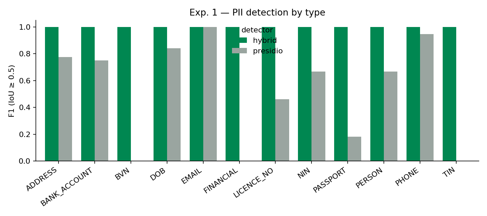
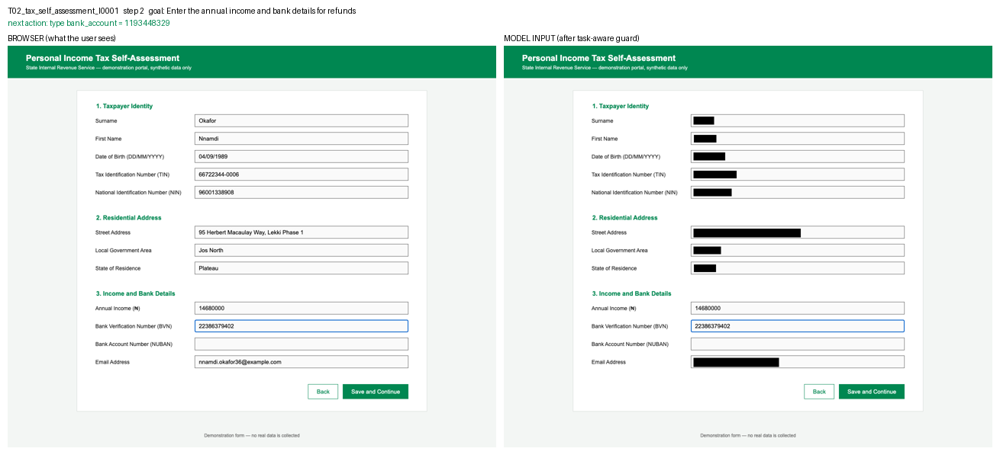

# Proof of Concept — progress report for the project supervisor

**Project:** Data minimization at the perception layer for screenshot-driven AI agents\
**Context:** Nigerian government e-services\
**Stage:** proof of concept built and partly evaluated · 15 October 2026\
**Repository:** `bessie/` (this folder) · full technical record in `PROJECT_RECORD.md`

---

## 1. What this document is

A summary of what has been done since Chapter One, the decisions taken along the way, the results
obtained so far, what remains, and the points on which your guidance would help. Everything described
here is reproducible from the repository with one setup command and one run command (see §8).

## 2. Recap of the aim

Chapter One identified that AI agents which operate government portals by reading screenshots send
those screenshots, full of personal data, to cloud-hosted models, and that no current governance
framework covers this visual channel. The aim is a *visual redaction guard* that masks personal
information in a screenshot before it leaves the user's machine, without stopping the agent from
completing its task.

## 3. Decisions taken to make this feasible as an undergraduate project

| Decision | Reason |
|---|---|
| **Nigerian context throughout** — tax self-assessment (State IRS), driver's licence renewal (FRSC), international passport application (NIS) | Services citizens actually use online; brings in identifiers (NIN, BVN, TIN, NUBAN, passport/licence formats) that off-the-shelf privacy tools do not know. Housing benefit was dropped as not applicable to Nigeria. |
| **No autonomous browser agent is built** | Building one is a project in itself and its randomness would swamp the measurements. The agent is *demonstrated* instead: utility is measured by asking a model to predict one step at a time on recorded gold trajectories (the standard offline evaluation used by web-agent benchmarks such as Mind2Web), and integration is shown with side-by-side images of browser view versus model input. |
| **Synthetic identities and mock portals** | No real personal data anywhere, so no ethics approval needed; and because I render the forms myself, exact ground-truth boxes come from the page itself with no manual annotation. |
| **Reproducibility first** | Pinned environment, one-command setup, seeded data generation, every model reply cached. Verified by rebuilding from a clean copy. |

## 4. What has been built

| Component | Status | Scale |
|---|---|---|
| Three mock Nigerian e-service forms with field manifests | done | 12 + 10 + 10 fields, 5 tasks |
| Synthetic identity generator | done | 50 identities, 12 PII types |
| Benchmark dataset with exact PII boxes from the DOM (Objective 1) | done | 450 screenshots, 2,400 annotated values |
| Recorded gold trajectories for the utility experiment | done | 15 trajectories, 51 decision steps, 495 values |
| Redaction guard: OCR → form-aware detection → policy → mask (Objective 2) | done | ~0.5 s per screenshot on a laptop CPU |
| Two policies: *full* (mask all) and *task-aware* (keep what the task needs) | done | |
| Generic baseline detector (Microsoft Presidio) for comparison | done | |
| Experiment 1 — detection quality (Objective 3) | **done** | 501 screenshots |
| Experiment 2 — what a vision model can still read after redaction (Objective 3) | written, not run | needs model API key |
| Experiment 3 — can the agent still choose the right action (Objective 4) | written, not run | needs model API key |
| Middleware demonstration (Objective 5) | done | 2 step-by-step demo GIFs |
| Automated results report | done | `results/REPORT.md` |

## 5. Results so far

### 5.1 Does the guard find the personal data? (Experiment 1)

Ground truth: 2,895 personal values across 501 screenshots. A value counts as found if the guard's
box overlaps the true text box by at least 50 %.

| Detector | Screenshots | Values | Precision | Recall | F1 | Correct type |
|---|---|---|---|---|---|---|
| **My guard** (reads the form's labels + patterns + NER) | 501 | 2,895 | 1.000 | 1.000 | 1.000 | 100 % |
| Presidio alone (generic, no form awareness) | 30 | 320 | 0.950 | 0.591 | 0.728 | 72.5 % |

What the baseline misses is the important part: it **never** finds a BVN, TIN or income figure,
finds only half of NINs and names, and when it does find a NIN, bank account or licence number it
labels it as something else every time. A generic privacy tool would leave four in ten personal
values on a Nigerian government form unmasked. Reading the form's own labels fixes this entirely on
my benchmark, and is also what lets the guard tell a NIN from a BVN (both are 11 digits).



### 5.2 Is it fast enough?

Median 488 ms per screenshot on CPU (OCR 447 ms, detection 17 ms, masking 24 ms). A model call in
an agent loop already takes several seconds, so the guard is not the bottleneck.

### 5.3 Does it demonstrate the middleware idea?

`demo/T02_tax_self_assessment_I0001.gif` and `demo/T04_drivers_licence_renewal_I0002.gif` show each
step of a task with the browser on the left and what the model receives on the right: the fields the
task needs stay readable, everything else is blacked out. Integration into an agent is one function
call on the screenshot before it is sent. One frame, task T02 (enter income and bank details), step 2:



## 6. The most useful thing I found

The first full run was *not* perfect: 9 values out of 2,895 were missed, and every one of them was
**the field the agent had just typed into**. The browser draws a blue focus ring around that input,
and the OCR engine's layout analysis skipped the text inside it. In other words the guard failed on
precisely the freshest personal data on screen, the value the user had just supplied, at every step.

It was fixed by neutralising the focus-ring colour before OCR, and the final run has zero errors.
But the finding matters beyond the fix: it only appeared because the trajectories were recorded
from live browser state rather than static mock-ups, and it suggests that any screenshot-based
privacy guard must be evaluated on screenshots that look the way an agent actually sees them.
(A second lesson: binarising the image to remove borders was tried and rejected because it made real
values unreadable, so the guard now keeps every OCR word regardless of confidence, on the principle
that a missed value is a privacy failure while an extra black box is only a utility cost.)

## 7. What remains, and where I need a decision

1. **Experiments 2 and 3 need a vision-model API key.** The scripts are written and tested; the cost
   is roughly 330 image calls (about 180 for leakage, 150 for step accuracy), cached so re-runs are
   free. *Decision needed:* can the department provide a key or small budget, or should I use a
   local open-weight vision model (slower, weaker, but free)?
2. **Paperasse access.** If the source is available, the guard can be inserted into it directly for
   the final demo; if not, an off-the-shelf Playwright + model loop stands in and the write-up says so.
3. **Honest framing of the perfect score.** The forms are clean and single-layout; I propose adding a
   second layout family per form (different fonts, placeholders instead of labels, two-column) to test
   how far the label-reading approach stretches. I would value your view on whether this belongs in
   the project or in future work.

## 8. Proposed next four weeks

| Week | Work |
|---|---|
| 1 | Run Experiments 2 and 3; produce the privacy-versus-utility figure; fill in §5 |
| 2 | Second layout family per form; re-run Experiment 1 to measure degradation |
| 3 | Live demo: guard inside an agent loop (Paperasse if available), one recorded run per task |
| 4 | Write up Chapters 3–5 from `PROJECT_RECORD.md` |

## 9. How to look at it yourself

```
cd bessie
./setup.sh            # one-time: Python environment, OCR model, headless browser
./run_all.sh          # regenerates everything; ~20 minutes on a laptop
```

Then open `results/REPORT.md` for the numbers, `results/figures/` for the charts, `demo/*.gif` for
the step-by-step demonstration, and `PROJECT_RECORD.md` for the full methodology and development log.

## 10. Questions for you

1. Is offline step-accuracy on recorded trajectories an acceptable substitute for closed-loop task
   success in the evaluation chapter, given the project's scope?
2. Should the second layout family (robustness test) be in scope, or noted as future work?
3. Any objection to the synthetic-identity approach for the ethics section?
