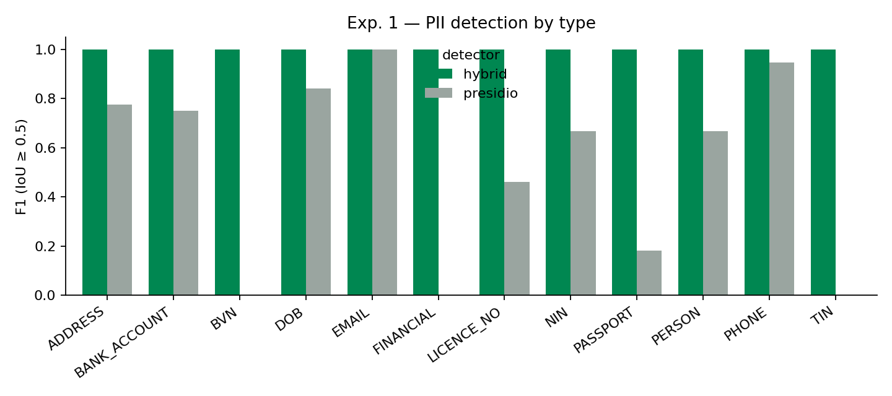

# Proof-of-concept results — perception-layer data minimization

_Generated 2026-10-15_

## Setup

- Benchmark: **450 screenshots** (3 mock Nigerian e-service forms × 50 synthetic identities × 3 fill states), ground truth from the DOM.
- Trajectories: **15 gold trajectories, 51 decision steps** (5 tasks × 3 identities).
- Guard: Tesseract OCR → label-context + pattern + Presidio detection → policy (full / task-aware) → mask.

## Experiment 1 — detection quality (vs DOM ground truth, IoU ≥ 0.5)

**Detector: `hybrid`** (501 screenshots)

| pii_type | n_gt | precision | recall | f1 | type_accuracy | mean_coverage |
|---|---|---|---|---|---|---|
| ADDRESS | 635 | 1.000 | 1.000 | 1.000 | 1.000 | 1.000 |
| BANK_ACCOUNT | 65 | 1.000 | 1.000 | 1.000 | 1.000 | 1.000 |
| BVN | 68 | 1.000 | 1.000 | 1.000 | 1.000 | 1.000 |
| DOB | 351 | 1.000 | 1.000 | 1.000 | 1.000 | 1.000 |
| EMAIL | 195 | 1.000 | 1.000 | 1.000 | 1.000 | 1.000 |
| FINANCIAL | 71 | 1.000 | 1.000 | 1.000 | 1.000 | 1.000 |
| LICENCE_NO | 115 | 1.000 | 1.000 | 1.000 | 1.000 | 1.000 |
| NIN | 342 | 1.000 | 1.000 | 1.000 | 1.000 | 1.000 |
| PASSPORT | 103 | 1.000 | 1.000 | 1.000 | 1.000 | 1.000 |
| PERSON | 702 | 1.000 | 1.000 | 1.000 | 1.000 | 1.000 |
| PHONE | 124 | 1.000 | 1.000 | 1.000 | 1.000 | 1.000 |
| TIN | 124 | 1.000 | 1.000 | 1.000 | 1.000 | 1.000 |
| ALL | 2895 | 1.000 | 1.000 | 1.000 | 1.000 | 1.000 |

**Detector: `presidio`** (30 screenshots)

| pii_type | n_gt | precision | recall | f1 | type_accuracy | mean_coverage |
|---|---|---|---|---|---|---|
| ADDRESS | 90 | 1.000 | 0.633 | 0.776 | 0.579 | 0.633 |
| BANK_ACCOUNT | 10 | 1.000 | 0.600 | 0.750 | 0.000 | 0.600 |
| BVN | 10 | 0.000 | 0.000 | 0.000 |  | 0.000 |
| DOB | 30 | 0.744 | 0.967 | 0.841 | 1.000 | 0.967 |
| EMAIL | 30 | 1.000 | 1.000 | 1.000 | 1.000 | 1.000 |
| FINANCIAL | 10 | 0.000 | 0.000 | 0.000 |  | 0.000 |
| LICENCE_NO | 10 | 1.000 | 0.300 | 0.462 | 0.000 | 0.300 |
| NIN | 30 | 1.000 | 0.500 | 0.667 | 0.000 | 0.500 |
| PASSPORT | 10 | 1.000 | 0.100 | 0.182 | 0.000 | 0.100 |
| PERSON | 60 | 1.000 | 0.500 | 0.667 | 0.900 | 0.500 |
| PHONE | 20 | 1.000 | 0.900 | 0.947 | 1.000 | 0.900 |
| TIN | 10 | 0.000 | 0.000 | 0.000 |  | 0.000 |
| ALL | 320 | 0.950 | 0.591 | 0.728 | 0.725 | 0.591 |

## Guard latency

Median per screenshot (n=501): OCR 447 ms, detect 17 ms, mask 24 ms — **488 ms total** on CPU.

## Experiment 2 — leakage

_Not run yet: needs `ANTHROPIC_API_KEY` in `.env`, then `scripts/06_eval_leakage.py`._

## Experiment 3 — step accuracy

_Not run yet: needs `ANTHROPIC_API_KEY` in `.env`, then `scripts/07_eval_step_accuracy.py`._

## Demo

- `demo/T02_tax_self_assessment_I0001.gif` — browser view vs model input, step by step
- `demo/T04_drivers_licence_renewal_I0002.gif` — browser view vs model input, step by step

## Finding worth noting

The first full run missed 9 of 2,895 values, and every one was the field the agent had *just typed into*: the browser's focus ring around that input made Tesseract skip its text. A guard that fails on exactly the value just entered would be worse than useless, so the OCR stage now neutralises focus-ring pixels before reading. This is the kind of perception-layer failure mode the project is about, and it only showed up because the trajectories were recorded with real browser state rather than static mock-ups.

## Limitations of this PoC

- Mock forms with a single layout family; real portals vary more.
- One OCR engine, one VLM; no adversarial inputs.
- Synthetic identities; name detection by generic NER is weak on Nigerian names, which is why the guard relies on label context.
