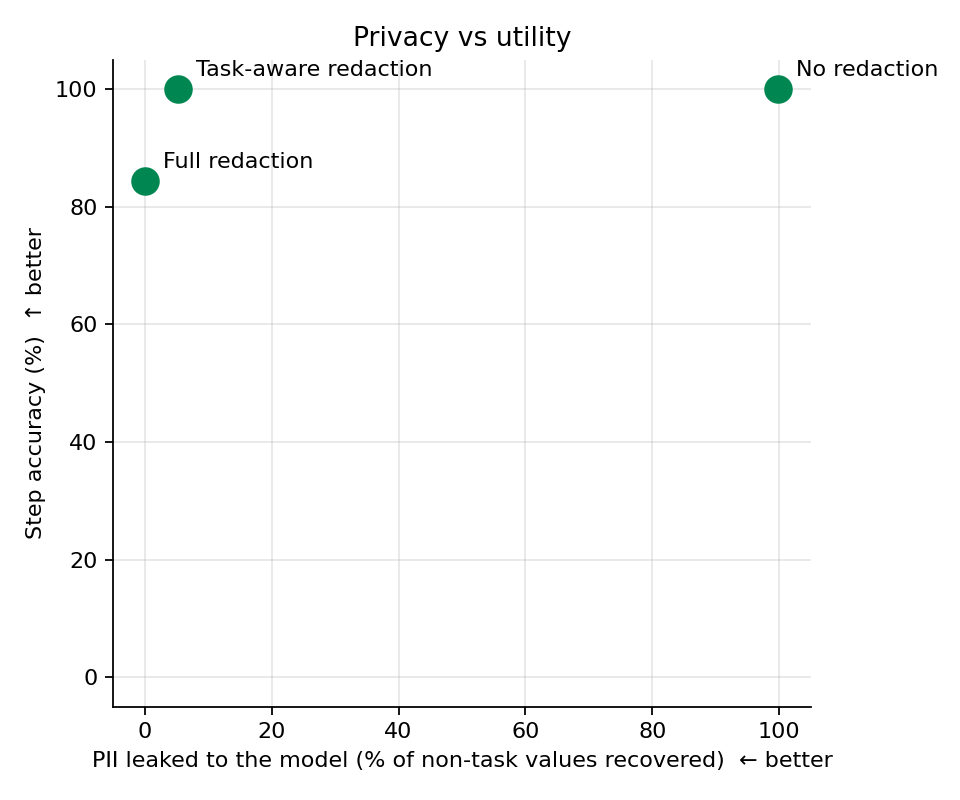

# Proof-of-concept results — perception-layer data minimization

_Generated 2026-11-13_

## Setup

- Benchmark: **450 screenshots** (3 mock Nigerian e-service forms × 50 synthetic identities × 3 fill states), ground truth from the DOM.
- Trajectories: **15 gold trajectories, 51 decision steps** (5 tasks × 3 identities).
- Guard: Tesseract OCR → label-context + pattern + Presidio detection → policy (full / task-aware) → mask.

## Experiment 1 — detection quality (vs DOM ground truth, IoU ≥ 0.5)

**Detector: `hybrid`** (501 screenshots)

| pii_type | n_gt | precision | recall | f1 | type_accuracy | mean_coverage |
|---|---|---|---|---|---|---|
| ADDRESS | 635 | 1.000 | 1.000 | 1.000 | 1.000 | 1.000 |
| BANK_ACCOUNT | 65 | 1.000 | 1.000 | 1.000 | 1.000 | 1.000 |
| BVN | 68 | 1.000 | 1.000 | 1.000 | 1.000 | 1.000 |
| DOB | 351 | 1.000 | 1.000 | 1.000 | 1.000 | 1.000 |
| EMAIL | 195 | 1.000 | 1.000 | 1.000 | 1.000 | 1.000 |
| FINANCIAL | 71 | 1.000 | 1.000 | 1.000 | 1.000 | 1.000 |
| LICENCE_NO | 115 | 1.000 | 1.000 | 1.000 | 1.000 | 1.000 |
| NIN | 342 | 1.000 | 1.000 | 1.000 | 1.000 | 1.000 |
| PASSPORT | 103 | 1.000 | 1.000 | 1.000 | 1.000 | 1.000 |
| PERSON | 702 | 1.000 | 1.000 | 1.000 | 1.000 | 1.000 |
| PHONE | 124 | 1.000 | 1.000 | 1.000 | 1.000 | 1.000 |
| TIN | 124 | 1.000 | 1.000 | 1.000 | 1.000 | 1.000 |
| ALL | 2895 | 1.000 | 1.000 | 1.000 | 1.000 | 1.000 |

**Detector: `presidio`** (501 screenshots)

| pii_type | n_gt | precision | recall | f1 | type_accuracy | mean_coverage |
|---|---|---|---|---|---|---|
| ADDRESS | 635 | 1.000 | 0.709 | 0.829 | 0.660 | 0.709 |
| BANK_ACCOUNT | 65 | 1.000 | 0.692 | 0.818 | 0.000 | 0.692 |
| BVN | 68 | 1.000 | 0.088 | 0.162 | 0.000 | 0.088 |
| DOB | 351 | 0.667 | 0.991 | 0.797 | 1.000 | 0.991 |
| EMAIL | 195 | 1.000 | 1.000 | 1.000 | 1.000 | 1.000 |
| FINANCIAL | 71 | 1.000 | 0.014 | 0.028 | 0.000 | 0.014 |
| LICENCE_NO | 115 | 1.000 | 0.148 | 0.258 | 0.000 | 0.148 |
| NIN | 342 | 1.000 | 0.281 | 0.438 | 0.000 | 0.281 |
| PASSPORT | 103 | 1.000 | 0.019 | 0.038 | 0.000 | 0.019 |
| PERSON | 702 | 1.000 | 0.484 | 0.653 | 0.859 | 0.484 |
| PHONE | 124 | 1.000 | 0.919 | 0.958 | 0.877 | 0.919 |
| TIN | 124 | 1.000 | 0.081 | 0.149 | 0.000 | 0.081 |
| ALL | 2895 | 0.903 | 0.561 | 0.692 | 0.759 | 0.561 |

## Guard latency

Median per screenshot (n=501): OCR 447 ms, detect 17 ms, mask 24 ms — **488 ms total** on CPU.

## Experiment 2 — leakage (what a VLM can still transcribe)

| condition | pii_type | n_values | leaked | leak_rate |
|---|---|---|---|---|
| raw | ADDRESS | 100 | 99 | 0.990 |
| raw | BANK_ACCOUNT | 10 | 10 | 1.000 |
| raw | BVN | 10 | 10 | 1.000 |
| raw | DOB | 60 | 60 | 1.000 |
| raw | EMAIL | 30 | 30 | 1.000 |
| raw | FINANCIAL | 10 | 10 | 1.000 |
| raw | LICENCE_NO | 20 | 20 | 1.000 |
| raw | NIN | 60 | 60 | 1.000 |
| raw | PASSPORT | 20 | 20 | 1.000 |
| raw | PERSON | 120 | 120 | 1.000 |
| raw | PHONE | 20 | 20 | 1.000 |
| raw | TIN | 20 | 20 | 1.000 |
| raw | ALL_NOT_NEEDED | 480 | 479 | 0.998 |
| full | ADDRESS | 100 | 0 | 0.000 |
| full | BANK_ACCOUNT | 10 | 0 | 0.000 |
| full | BVN | 10 | 0 | 0.000 |
| full | DOB | 60 | 0 | 0.000 |
| full | EMAIL | 30 | 0 | 0.000 |
| full | FINANCIAL | 10 | 0 | 0.000 |
| full | LICENCE_NO | 20 | 0 | 0.000 |
| full | NIN | 60 | 0 | 0.000 |
| full | PASSPORT | 20 | 0 | 0.000 |
| full | PERSON | 120 | 0 | 0.000 |
| full | PHONE | 20 | 0 | 0.000 |
| full | TIN | 20 | 0 | 0.000 |
| full | ALL_NOT_NEEDED | 480 | 0 | 0.000 |
| task_aware | ADDRESS | 60 | 0 | 0.000 |
| task_aware | BANK_ACCOUNT | 10 | 0 | 0.000 |
| task_aware | BVN | 10 | 0 | 0.000 |
| task_aware | DOB | 60 | 0 | 0.000 |
| task_aware | EMAIL | 20 | 0 | 0.000 |
| task_aware | FINANCIAL | 10 | 0 | 0.000 |
| task_aware | LICENCE_NO | 20 | 0 | 0.000 |
| task_aware | NIN | 40 | 0 | 0.000 |
| task_aware | PERSON | 120 | 20 | 0.167 |
| task_aware | PHONE | 10 | 0 | 0.000 |
| task_aware | TIN | 20 | 0 | 0.000 |
| task_aware | needed | 100 | 99 | 0.990 |
| task_aware | ALL_NOT_NEEDED | 380 | 20 | 0.053 |

## Experiment 3 — offline step accuracy

| task | condition | n_steps | field_accuracy | step_accuracy |
|---|---|---|---|---|
| ALL | full | 51 | 0.843 | 0.843 |
| ALL | raw | 51 | 1.000 | 1.000 |
| ALL | task_aware | 51 | 1.000 | 1.000 |
| T01 | full | 12 | 0.750 | 0.750 |
| T01 | raw | 12 | 1.000 | 1.000 |
| T01 | task_aware | 12 | 1.000 | 1.000 |
| T02 | full | 12 | 0.917 | 0.917 |
| T02 | raw | 12 | 1.000 | 1.000 |
| T02 | task_aware | 12 | 1.000 | 1.000 |
| T03 | full | 9 | 0.778 | 0.778 |
| T03 | raw | 9 | 1.000 | 1.000 |
| T03 | task_aware | 9 | 1.000 | 1.000 |
| T04 | full | 9 | 0.889 | 0.889 |
| T04 | raw | 9 | 1.000 | 1.000 |
| T04 | task_aware | 9 | 1.000 | 1.000 |
| T05 | full | 9 | 0.889 | 0.889 |
| T05 | raw | 9 | 1.000 | 1.000 |
| T05 | task_aware | 9 | 1.000 | 1.000 |

## Demo

- `demo/T02_tax_self_assessment_I0001.gif` — browser view vs model input, step by step
- `demo/T04_drivers_licence_renewal_I0002.gif` — browser view vs model input, step by step

## Finding worth noting

The first full run missed 9 of 2,895 values, and every one was the field the agent had *just typed into*: the browser's focus ring around that input made Tesseract skip its text. A guard that fails on exactly the value just entered would be worse than useless, so the OCR stage now neutralises focus-ring pixels before reading. This is the kind of perception-layer failure mode the project is about, and it only showed up because the trajectories were recorded with real browser state rather than static mock-ups.

## Limitations of this PoC

- Mock forms with a single layout family; real portals vary more.
- One OCR engine, one VLM; no adversarial inputs.
- Synthetic identities; name detection by generic NER is weak on Nigerian names, which is why the guard relies on label context.
